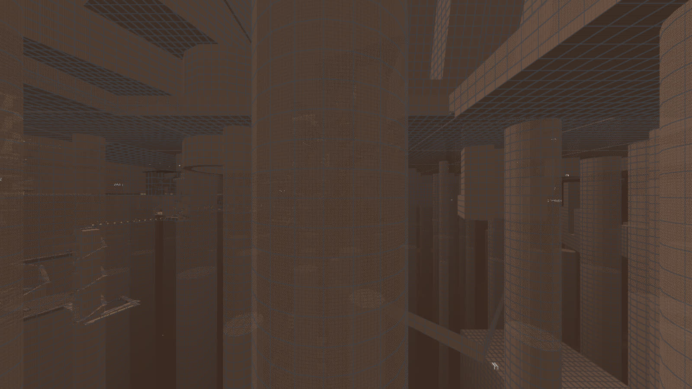

# Superstruct

A first-person walking game set in a procedurally generated megastructure that never ends,
in any direction. There is no combat and no jumping: you walk, ride lifts and trams, and
anything you can see on the horizon can be reached.



Work in progress. The art is placeholder; atmosphere, audio and polish are still to come.

## Running it

You need Rust (the toolchain is pinned in `rust-toolchain.toml`) and a GPU with Vulkan or
DirectX 12.

```bash
cargo run -p game --release
```

Controls are in [docs/controls.md](docs/controls.md). The game targets Windows. On WSL, wgpu
may fall back to software rendering, which is fine for tests but not for playing.

## How the world works

The world is a pure function of the seed and integer cell coordinates, so a tower seen 20 km
away is the same tower when you get there, whichever way you came. Generation runs top down,
from 32 km regions to 4 m wall modules, and each level only refines what its parent decided.
Neighbouring cells derive the openings on their shared face from a hash of that face, so they
agree without talking to each other. Positions are an `i64` sector plus an `f32` offset.

The design notes are in [PLAN.md](PLAN.md) and the specs in [docs/spec](docs/spec).

## Layout

| Path | What it is |
|---|---|
| `crates/gen` | World generator (library `worldgen`) |
| `crates/engine` | Renderer, streaming and player controller (wgpu, winit) |
| `crates/game` | The game binary |
| `tools/slice` | Cross-section images and connectivity reports |
| `tools/bots` | Headless walkers that measure the generated world |
| `tools/web-report` | Checks the world against the design targets |

`scripts/check.sh` runs formatting, clippy and the tests.
